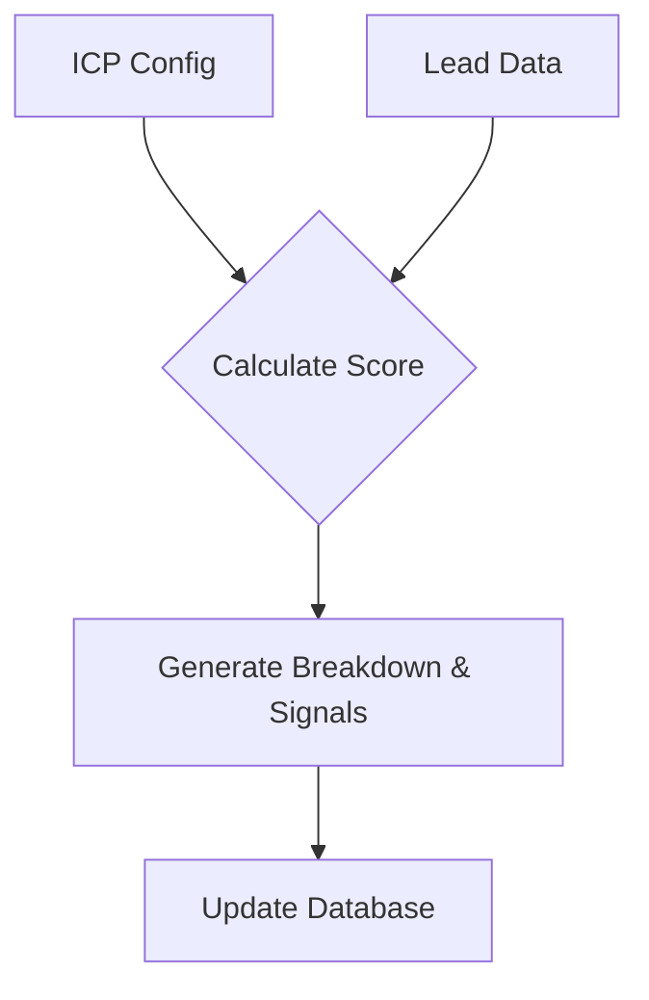

# Architecture Overview

## System Overview
The system follows a modern 3-tier architecture:
- **Frontend:** React Single Page Application (SPA)
- **Backend:** FastAPI REST API
- **Database:** SQLite (via SQLAlchemy ORM)

## Frontend Architecture
- **Framework:** Vite + React + TypeScript
- **Routing:** React Router for navigation
- **Styling:** Tailwind CSS (utility-first)
- **Structure:**
  - Page components (Dashboard, Import)
  - Shared components (Table, Badges, Forms)
  - Custom hooks for state management
  - API service layer for backend communication

## Backend Architecture
- **Framework:** FastAPI with CORS middleware
- **Design Pattern:** Layered architecture
  - **Route Handlers:** Thin controllers that receive requests and return responses
  - **Service Layer:** Contains business logic (scoring, validation, deduplication)
  - **Repository Layer:** Data access layer interacting with the database
- **Validation:** Pydantic schemas enforce type safety and data boundaries
- **ORM:** SQLAlchemy manages database models and migrations

## Data Flow
```mermaid
flowchart TD
    A[CSV Upload] --> B[Normalization]
    B --> C[Validation]
    C --> D[Deduplication]
    D --> E[Storage (SQLite)]
```

## Scoring Flow


## Import Flow
1. CSV upload via frontend
2. Header mapping and row parsing
3. Normalization (domains, names)
4. Validation (email formats, URLs)
5. Deduplication (check existing records)
6. Bulk insert to database
7. Return result summary

## Deduplication Flow
1. Normalize domain
2. Check existing records by domain
3. If match found, merge fields (preferring more complete data)
4. If no domain exists, try fallback matching by normalized company name + state
5. Report detected duplicates in import summary

## Database Model
**Table: Leads**
- `id` (PK, UUID)
- `company_name` (String, Indexed)
- `domain` (String, Indexed)
- `industry` (String, Indexed)
- `state` (String, Indexed)
- `revenue` (Float)
- `employee_count` (Integer)
- `fit_score` (Integer, Indexed)
- `priority` (String, Indexed)
- Additional contact and metadata fields

## API Design
- **RESTful Conventions:** Standard HTTP methods (GET, POST)
- **Pagination:** Uses `skip` and `limit` parameters
- **Error Responses:** Standardized JSON error format
- **Filtering:** Query parameters for searching and filtering leads

## Caching
- **Prototype:** In-process caching for repeated stat/filter queries during a session
- **Production (Future):** Redis for shared caching across instances and rate limiting

## Performance
- Indexes on frequently queried columns
- Pagination (default 20 rows, up to 100)
- Backend-side filtering and sorting to minimize data transfer

## Deployment Architecture
- **Frontend:** CDN or static hosting (e.g., Vercel, Netlify)
- **Backend:** API server (e.g., Render, Railway)
- **Database:** PostgreSQL (managed instance)

## Production Scaling Path
1. Migrate from SQLite to PostgreSQL
2. Add Redis for caching and session management
3. Introduce a background job queue (e.g., Celery) for async scoring of large datasets
4. Deploy API behind a load balancer with multiple instances
5. Implement authentication and rate limiting
