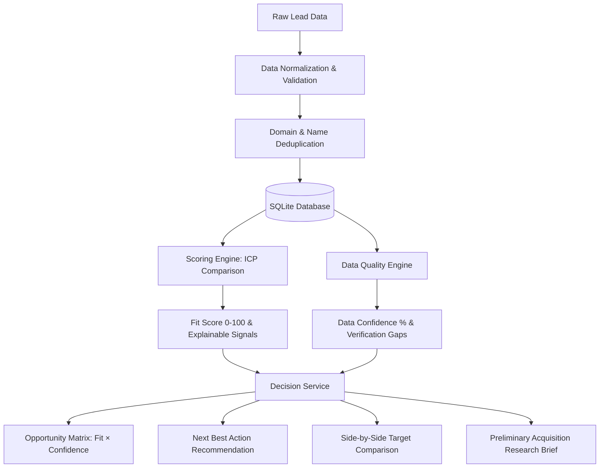

# Architecture Overview

## System Architecture

The Acquisition Fit Workbench follows a decoupled 3-tier layered architecture:
- **Presentation Layer:** React 19 Single Page Application (TypeScript, Tailwind CSS, Vite)
- **Application & API Layer:** FastAPI (Python 3.13) with strict Pydantic v2 data contracts
- **Data & Storage Layer:** SQLite with composite B-tree indices (managed via SQLAlchemy 2.0 ORM)

---

## 1. Frontend Architecture
- **Framework:** React 19 + TypeScript + Vite
- **Styling:** Tailwind CSS (custom slate/indigo investment terminal design system)
- **Routing:** React Router v6
- **Component Breakdown:**
  - `ExecutiveView.tsx`: High-level command center with KPI strip, Opportunity Matrix, Today's Research Queue, and Pipeline Insights.
  - `OpportunityMatrix.tsx`: Interactive SVG scatter plot mapping Fit Score (Y) against Data Confidence (X) across 4 quadrants.
  - `ResearchQueue.tsx`: Ranked priority list displaying Why It Matters and Next Best Action.
  - `ResearchView.tsx` / `LeadTable.tsx`: Granular 11-column data grid with server-side pagination, sorting, shortlist stars, and compare selection.
  - `CompareModal.tsx`: Side-by-side evaluation matrix for 2 or 3 targets with objective criteria highlights.
  - `AcquisitionBriefModal.tsx`: Printable Preliminary Acquisition Research Brief with instant PDF styling.
  - `LeadDetailDrawer.tsx`: Executive target profile with 5-second summary, next action, and verification gaps checklist.
  - `ICPForm.tsx`: Ideal Company Profile criteria configuration panel.

---

## 2. Backend Architecture
The backend is structured into distinct layers following Clean Architecture principles:

- **Route Controllers (`app/api/routes/`):**
  - `health.py`: Liveness and readiness probes.
  - `scoring.py`: ICP evaluation and batch pipeline scoring.
  - `decision.py`: `/api/insights`, `/api/leads/{id}/decision-summary`, `/api/leads/compare`, `/api/shortlist`, `/api/brief/{id}`.
  - `leads.py`: Lead querying, full-text search, multi-criteria filtering, and pagination.
  - `import_export.py`: Multipart CSV ingestion, audit reporting, and filtered CSV export.
  - `stats.py`: High-level pipeline metrics.

- **Service Layer (`app/services/`):**
  - `scoring_service.py`: 8-factor deterministic scoring engine (clamped 0–100, exclusion keywords, positive/negative signals).
  - `decision_service.py`: Quadrant calculation, deterministic Next Best Action logic, verification gaps auditing, target comparison highlights, and brief generation.
  - `normalization_service.py`: Canonical domain extraction, company legal suffix cleaning, phone and LinkedIn formatting.
  - `validation_service.py`: Field presence, format validity, non-negative numbers, and calendar boundaries.
  - `deduplication_service.py`: Primary domain matching with fallback to normalized company name + state.
  - `import_service.py` & `export_service.py`: Ingestion parsing and targeted CSV generation.

- **Repository Layer (`app/repositories/lead_repository.py`):**
  - Decoupled database access layer handling SQL filtering, sorting, pagination, shortlist persistence, and exact count statistics.

- **Data Model (`app/models/lead.py`):**
  - Indexed fields: `fit_score`, `priority`, `revenue`, `employee_count`, `data_quality_score`, `is_shortlisted`.

---

## 3. Decision Intelligence Data Flow

---

## 4. Invariant Protection: Exact Lead Accounting
The database maintains an invariant partition:
$$\text{Total Leads} = \text{High Priority} + \text{Medium Priority} + \text{Low Priority} + \text{Unscored Leads}$$

This is guaranteed at the repository and schema level:
- Unscored leads default to `priority = 'UNSCORED'` and `fit_score = None`.
- Scoring assigns leads strictly to `HIGH` ($\ge 80$), `MEDIUM` ($60\text{--}79$), or `LOW` ($< 60$).
- `total == high + medium + low + unscored` holds unconditionally across all API responses.
